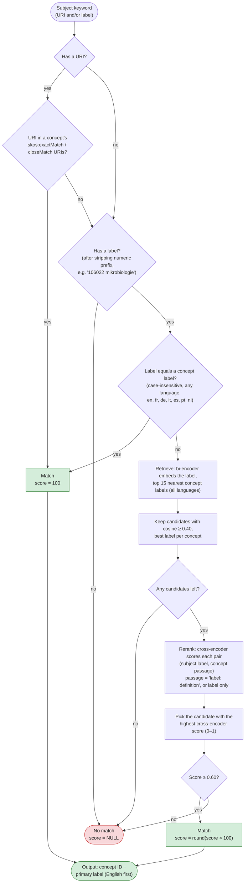

# Keyword-Matcher and Keyword-Extractor

## Objective
The objective is to make records in the soilwise metadata catalogue more FAIR (Findable, Accessible, Interoperable and Reusable) by linking their subject metadata to standard vocabularies such as [SoilVoc](https://w3id.org/eusoilvoc). The keyword matcher aligns keywords already present in a record with relevant SoilVoc concepts, while the keyword extractor identifies relevant concepts from the record’s text when subject metadata is missing or incomplete.

## Architecture

### Database structure

### Workflow:

#### Keyword matcher

For each keyword or subject in a record, identify if it matches with a keyword from a preselected list of relevant terms (SoilVoc).
Matching is based on label translation, synonyms, sameAs/closeMatch/exactMatch relationships.

#### Keyword extractor 

The textual content of the record (title, abstract, full text) is analysed to extract relevant keywords from a preselected list of relevant terms (SoilVoc).

## Methods exploration: keyword-matcher
V1.0 (current status):\
Use fuzzy match, few records have matched keywords, FP by fuzzy.

[flowchart]

v2.0 (ongoing work):\
To introduce other matching techniques to support or replace fuzzy.

### Techniques
- Embedding (bi-encoder): ...
- Cross-encoder: ...
- Machine translate: ...

### Approaches
table to explain the 4 approached

### Experiment
Experiment plan. \
Explanation of some decision points.

### Evaluation
Plan, result and conclusion. Use appr4.

## Methods exploration: keyword-extractor
v1.0: (ongoing work)
to enrich the keywords field from metadata (title and abstract)

### Techniques
- Embedding and cross-encoder
- Keybert
- LLM (KeyLLM)

### Experiments and evaluation
...

